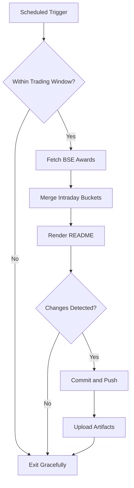

# Bombay Duck 🦆

     

<!-- aim:start -->

## Aim 🎯

⚠️ **Caution:\*\*** This project does not recommend buying or selling any security; it simply tracks BSE "Award of Order / Receipt of Order" announcements for informational purposes.

Bombay Duck keeps a pulse on BSE's "Award of Order / Receipt of Order" announcements so traders can spot fresh bullish catalysts without refreshing the exchange site. The goal is a hands-free tracker that respects BSE rate limits, stores every intraday fetch in git, and keeps the repository's front page as a living dashboard.

<!-- aim:end -->

## Intraday Snapshot 📊

ℹ️ **Important:\*\*** The README snapshot is updated automatically by the scheduled GitHub Action. Always pull the latest changes (or rebase) before editing README content locally to avoid merge conflicts.

<!-- snapshot:start -->

### Today's Awarded Orders (2026-10-16 IST)

| Hour (IST) | Company | Code | Headline | Profit Outlook | Announced At |
| --- | --- | --- | --- | --- | --- |
| 2026-10-16 13:00 | Newgen Software Technologies Ltd | 540900 | Enclosed Material Order disclosure of Rs. 20.51 Cr. ([Link](https://www.bseindia.com/stock-share-price/newgen-software-technologies-ltd/newgen/540900/)) | Likely Positive | 16 Oct 2026 - 13:07 |
| 2026-10-16 12:00 | Siyaram Recycling Industries Ltd | 544047 | Attached Intimation for Award/Reciept of Order receieved by the Company ([Link](https://www.bseindia.com/stock-share-price/siyaram-recycling-industries-ltd/siyaram/544047/)) | Likely Positive | 16 Oct 2026 - 12:52 |
| 2026-10-16 12:00 | ITCONS E-Solutions Ltd | 543806 | We are pleased to inform you that our Company has bagged a new contract from Indian Army, Department of Military Affairs, Ministry of Defence of contract value of Rs. 6741660.26. For further .... ([Link](https://www.bseindia.com/stock-share-price/itcons-e-solutions-ltd/itcons/543806/)) | Likely Positive | 16 Oct 2026 - 12:16 |
| 2026-10-16 08:00 | Organic Recycling Systems Ltd | 543997 | Solapur Bioenergy Systems Private Limited, Wholly Owned Subsidiary of Organic Recycling Systems Limited secures 05th Large Scale Contract for CBG Project from BPCL in Chhattisgarh. ([Link](https://www.bseindia.com/stock-share-price/organic-recycling-systems-ltd/organicrec/543997/)) | Likely Positive | 16 Oct 2026 - 08:31 |
| 2026-10-16 08:00 | Vascon Engineers Ltd | 533156 | Vascon Engineers Limited receives Letter of Acceptance From State Bank of India amounting to Rs. 198 Crore for construction of SBILD, Residential Flats and other commercial outfits at Hinjewadi, .... ([Link](https://www.bseindia.com/stock-share-price/vascon-engineers-ltd/vasconeq/533156/)) | Neutral | 16 Oct 2026 - 08:19 |

_Last updated: 16 Oct 2026 - 13:15 | Entries: 5 | Requests: 1 | Retries: 0 | [Raw JSON](data/2026-10-16.json)_

<!-- snapshot:end -->

<!-- how-it-works:start -->

## How It Works ⚙️

1. Scheduled GitHub Action runs at the top of each hour from 09:00 to 16:00 IST, Monday through Friday.
2. Trading-window guard aborts early outside market hours or on weekends/holidays.
3. Node.js fetcher (with throttling and retries) polls the BSE API and archives the raw JSON response.
4. Intraday state manager deduplicates announcements per hour and rolls over automatically at the next market open.
5. Mustache-based renderer injects a fresh table into the README so the latest data is always visible.
6. If anything changed, the workflow commits the README and JSON state back to `main` using a bot token and uploads artifacts for auditing.

<!-- how-it-works:end -->

## Automation Timeline 🕒

- **09:00 IST**: First eligible run clears out yesterday's state, fetches fresh announcements, and resets the README snapshot.
- **09:15-15:00 IST**: At the top of each hour the workflow repeats the fetch->merge->render pipeline, committing only when new data appears.
- **After 15:00 IST**: Guard step exits successfully; the last intraday snapshot remains until markets reopen.

## Project Resources 📚

- 📘 [Contributing Guidelines](CONTRIBUTING.md)
- 🧾 [Pull Request Guide](PR_GUIDE.md)
- 🐞 [Known Issues](KNOWN_ISSUES.md)
- 👥 [Authors](AUTHORS.md)

## Appendix 📎

- **API Endpoint:** `https://api.bseindia.com/BseIndiaAPI/api/AnnSubCategoryGetData/w`
- **Query Parameters:** `strCat=Company Update`, `subcategory=Award of Order / Receipt of Order`; date fields align with the active IST trading day.
- **Outputs:** Exposes `trading_date`, `announcement_count`, and the JSON-encoded announcements via `GITHUB_OUTPUT` for downstream jobs.
- **Logs & Summaries:** Fetch step writes a Markdown table to the GitHub Step Summary for quick triage.
